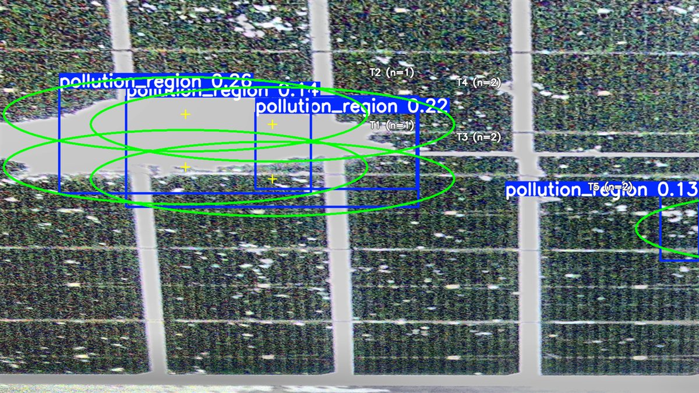
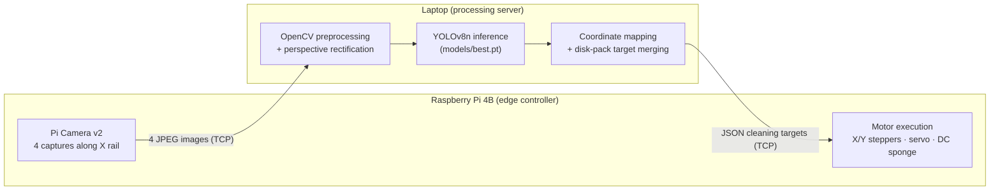
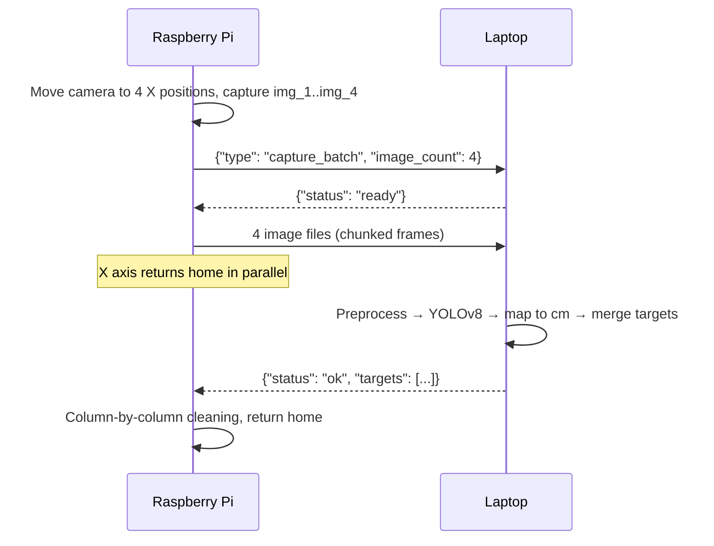
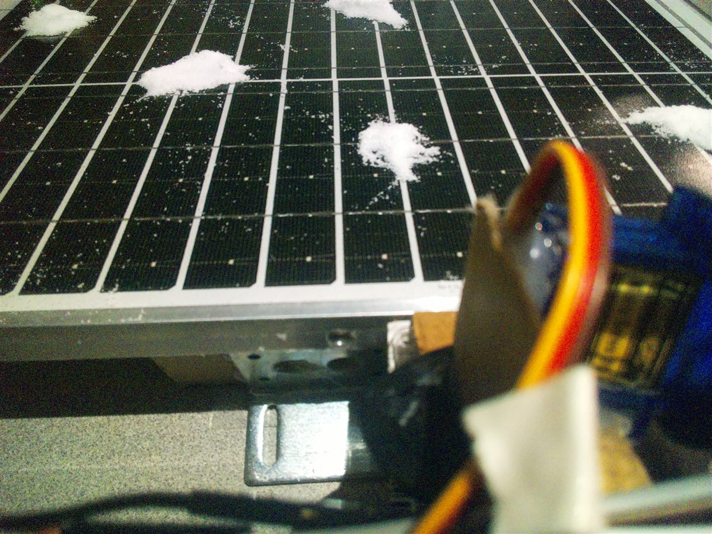
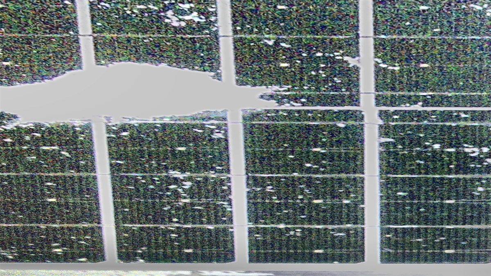
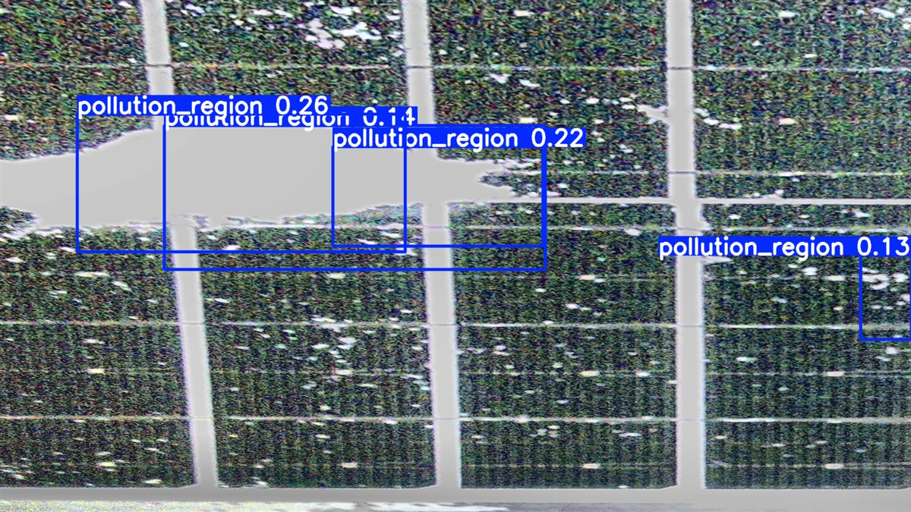

# Autonomous Solar Panel Cleaning System

**Vision-guided selective cleaning for floating solar panels using YOLOv8, OpenCV, Raspberry Pi, and Python-based hardware automation.**


> NUS Undergraduate Research Experience Programme (UREx), AY2025/26 · 4-member team · Supervisor: Assoc. Prof. Abdullah Al Mamun

Floating photovoltaic (FPV) panels in coastal environments lose output as salt crystallises on the glass. Conventional cleaning robots sweep the entire surface on a fixed schedule and need precision-aligned rails along the full panel perimeter. This project builds a prototype that **looks first and cleans only where salt is detected**: a Raspberry Pi photographs the panel, a laptop runs a YOLOv8 detector and plans the cleaning path, and the Pi drives a two-axis mechanism to place a rotating sponge on each contaminated region.

<p align="center">
  
  <br><em>Live system output: YOLOv8 salt detections (blue boxes) merged into sponge-sized cleaning targets (green, labelled T1–T5).</em>
</p>

---

## Key Results

| Metric | Result | Test conditions |
|---|---|---|
| Mean positioning error | **0.65 cm** (measured) | A reference sticker was placed at 10 known points across the 30.8 × 21.1 cm panel. The system drove the sponge to each point using the full coordinate-mapping and motor pipeline, and the offset was measured with a ruler. Range 0.48–0.83 cm; all 10 points were below the 1.0 cm target and well inside the 1.9 cm sponge radius. |
| Motor runtime reduction | **~68%** (estimated) | Selective cleaning of a 6-target scenario (24 s motor runtime) compared with a *calculated* full-surface traversal baseline (10 X steps × 6.8 s + 5 Y steps × 1.2 s = 74 s, rounded to 75 s in the report). |
| Cleaning trials | 18 trials, ~78% mean removal | Light, moderate, and heavy salt contamination |

Figures are from the final research report ([`docs/CDE2605R_public.pdf`](docs/CDE2605R_public.pdf), Section 7). Experiments were run on a single-panel laboratory mockup under controlled lighting. Detection accuracy metrics are being re-verified against the original evaluation records and will be added once confirmed.

---

## My Contribution

I (**Cao Jiashuo**) was responsible for the software and the software–hardware integration:

- **Image recognition:** YOLOv8 salt-residue detection pipeline
- **Image preprocessing:** white balance, exposure normalisation, glare suppression, CLAHE, and four-tile perspective rectification
- **Motion control:** stepper-motor (X/Y) and servo control, coordinate mapping, and cleaning-path planning
- **System integration:** the distributed Raspberry Pi ↔ laptop orchestrator that runs the full capture → detect → plan → clean cycle

---

## System Architecture



The work is split by hardware capability: the **Pi** handles everything physical (camera, GPIO, motors), while the **laptop** runs the computationally heavy vision and planning steps. Both roles are implemented in one script, [`src/fpv_main_orchestrator.py`](src/fpv_main_orchestrator.py), selected by a `pi` / `laptop` sub-command.

### Distributed communication

The two nodes talk over a lightweight custom TCP protocol (port 5001). Every message is **length-prefixed** (8-byte big-endian header + payload), so images and JSON share one connection without delimiter ambiguity.



The image upload runs in a background thread so the X axis can **return home while the images are still being transferred**, overlapping mechanical and network latency.

---

## Vision Pipeline

| 1 · Raw capture (Pi Camera) | 2 · Preprocessed + rectified | 3 · YOLOv8 detections |
|---|---|---|
|  |  |  |

Step 4, merging detections into cleaning targets, is shown in the image at the top of this page.

**Capture.** The camera rides on the X carriage and takes four 3280 × 2464 images at X = 9.6, 17.6, 25.5 and 33.2 cm. Each image covers one quarter of the panel (4 of the 16 cell columns).

**Preprocessing** ([`left_fixpreprocess.py`](src/left_fixpreprocess.py), [`fix_2_preprocess.py`](src/fix_2_preprocess.py)):
1. Gray-world white balance, to remove colour casts from lab lighting
2. Exposure normalisation to a fixed mean brightness
3. Glare suppression: low-saturation, high-value pixels (specular reflections) are masked and attenuated
4. CLAHE on the LAB lightness channel, for local contrast on the dark cell texture
5. Perspective warp of each tile to a 1600 × 900 top-down view, using four calibrated corner points per camera position

**Detection** ([`run_pair_preprocess_detect.py`](src/run_pair_preprocess_detect.py)): a custom-trained YOLOv8n model ([`models/best.pt`](models/best.pt), class `pollution_region`) runs on each rectified tile and writes normalised YOLO labels plus annotated overlays.

---

## Coordinate Mapping and Selective Cleaning

Implemented in [`src/shuo.py`](src/shuo.py).

**1 · Tile-local → board coordinates.** Each normalised YOLO box in tile *i* is mapped to physical centimetres:

```
board_x = origin_x[i] + xc · (30.8 cm / 4)
board_y = (1 − yc) · 21.1 cm
```

then shifted by a calibrated camera-to-sponge offset (+1.8 cm in Y).

**2 · Disk-pack merging.** Many small detections do not each need a separate sponge placement. A greedy 2-D packing algorithm merges detections whose combined bounding box still fits inside the sponge's **3.8 cm effective footprint**, and splits any detection larger than the sponge into a grid of sub-targets. Every detected pixel is therefore covered by at least one placement while the number of stops stays small.

**3 · Motor-frame compensation.** A calibrated X remap is applied before the targets are sent to the Pi: targets at X ≤ 3 cm are skipped, and the remaining X coordinates are shifted by −3 cm.

---

## Motor Control and Execution

| Component | Implementation |
|---|---|
| X axis (lateral) | NEMA 17 on a top-edge 2040 V-slot rail, GT2 belt, A4988 driver at 4× microstepping, 0.02 cm/step |
| Y axis (down-slope) | NEMA 17 spool paying out yarn; the cleaning module descends the inclined panel under **gravity**. A4988 at 16× microstepping, 0.02 cm/step |
| Cleaning head | Servo lowers a melamine-foam sponge; a DC motor spins it for a set dwell time |
| Controller | Raspberry Pi 4B driving all drivers directly over GPIO (no intermediate MCU) |

**Column-chained visit order.** Targets whose X positions differ by ≤ 0.3 cm are grouped into one column. For each column the carriage moves X once, then visits targets in increasing Y. Y returns to zero only **once per column** instead of after every target, which cuts spool travel and avoids the module swinging after long gravity drops.

**Per target:** move Y → servo down → DC motor on for the dwell time (default 1 s) → motor off → servo up. `try/finally` blocks make sure the DC motor is switched off, the servo raised, and the drivers disabled even if a run is interrupted.

---

## Engineering Challenges and Design Decisions

| Challenge | Decision |
|---|---|
| Keeping heavy vision compute off the motor controller | Moved preprocessing and YOLOv8 inference to a laptop over Wi-Fi; the Pi handles only camera and real-time GPIO |
| Specular glare on panel glass looks like white salt | Glare masking in preprocessing; documented as the main remaining false-positive source |
| One wide-angle image distorts the panel geometry | Four overlapping captures along the rail, each rectified with its own calibrated homography |
| Full-length dual rails are impractical on floating installations | A single top-edge rail plus a gravity-fed spool covers the full 2-D surface |
| Raw detections are fragmented and overlapping | Sponge-sized disk-pack merging turns N detections into the minimum practical number of placements |
| Network transfer adds latency | Image upload overlaps with the X-axis homing move |

---

## Limitations

- **Prototype scope:** a single panel (30.8 × 21.1 cm) in a lab with controlled lighting and salt applied by hand. Results have not been validated on a real floating installation.
- **Glare false positives:** strong reflections can still be classified as salt.
- **Missed detections:** in the demo session, one tile with a visible salt patch along its edge produced no detection. The detector runs at a low confidence threshold (0.1), and the detections shown above score only 0.13–0.26, so detection robustness is the main area for improvement.
- **Fixed calibration:** perspective points and physical constants are hard-coded for one rig; moving the camera means recalibrating (see [`docs/usage.md`](docs/usage.md#4-calibration)).
- **Bounding boxes, not masks:** box-based detection over-covers irregular residue; segmentation is listed as future work.
- **Lab-grade networking:** the TCP link has no authentication or encryption.
- **Calculated baseline:** the 68% runtime reduction is measured against a calculated, not measured, full-surface baseline.

---

## Repository Structure

```
solar-panel-cleaning-automation/
├── src/
│   ├── fpv_main_orchestrator.py        # Entry point: `pi` and `laptop` roles, TCP protocol, execution
│   ├── shuo.py                         # Motor drivers, coordinate mapping, disk-pack planner, overlays
│   ├── run_pair_preprocess_detect.py   # Preprocess 4 tiles + YOLOv8 inference
│   ├── fix_2_preprocess.py             # Per-position calibrated perspective rectification
│   ├── left_fixpreprocess.py           # Shared image-enhancement functions
│   ├── manual_calibrate_four_tiles.py  # Interactive corner-point calibration tool
│   ├── manual_perspective_calibrate.py # Calibration helpers
│   └── test_*.py, x_position_test.py   # Hardware bring-up tests
├── models/best.pt                      # Trained YOLOv8n weights (~6 MB)
├── docs/
│   ├── CDE2605R_public.pdf             # Final research report (student IDs redacted)
│   ├── usage.md                        # Setup, run, and calibration guide
│   └── images/                         # README figures
├── requirements.txt                    # Laptop dependencies
└── requirements-pi.txt                 # Raspberry Pi dependencies
```

## Quick Start

```bash
pip install -r requirements.txt
cd src

# Laptop-only test on your own 4 captures (no hardware needed)
python run_pair_preprocess_detect.py <image_folder> --model ../models/best.pt --out-dir <output_folder>

# Full system: start the laptop server, then the Pi client
python fpv_main_orchestrator.py laptop --model-path ../models/best.pt --shuo-script shuo.py
python3 fpv_main_orchestrator.py pi --laptop-host <LAPTOP_IP> --shuo-script shuo.py   # on the Pi
```

See [`docs/usage.md`](docs/usage.md) for the Pi setup, all options, `--dry-run`, and calibration.

> **Note:** the full pipeline needs the physical rig (Pi Camera, stepper drivers, servo, DC motor). The laptop-side vision pipeline runs on any machine.

---

## Research Context and Acknowledgments

This project was carried out under the **NUS Undergraduate Research Experience Programme (UREx)** at the National University of Singapore, from AY2025/26 Semester 1 to Semester 2.

**Team:** Cao Jiashuo · Chang Yichun · Li Minxi · Qi Ye

**Supervisor:** Associate Professor Abdullah Al Mamun

The full methodology, literature review, electrical and mechanical design, and experimental data are in the final report: [`docs/CDE2605R_public.pdf`](docs/CDE2605R_public.pdf).

---

<sub>© 2026 Cao Jiashuo and team. All rights reserved. No licence is granted for reuse of this code or report without permission.</sub>
